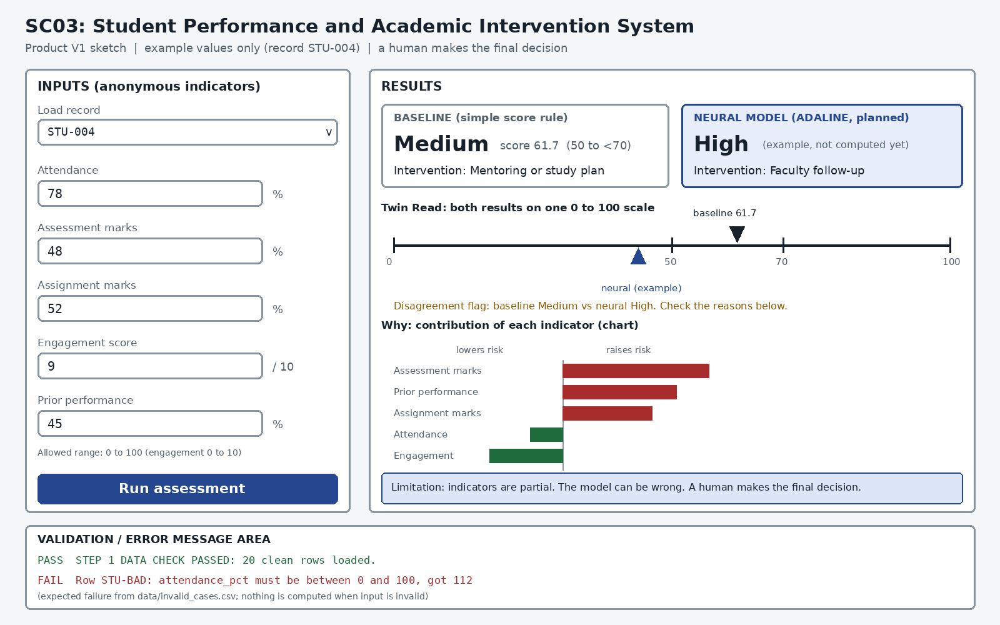

# Step 1 Project Contract — SC03

## 1. Team and Responsibilities

| Member Name | Assigned Role | Step 1 Responsibilities | Milestone Focus (M1 / M2) |
| :--- | :--- | :--- | :--- |
| **Deepak Gupta** | Repository & Architecture Lead | Repository setup, GitHub governance, branching model, folder structure | Backend architecture, RBAC, deployment |
| **Himanshu Rai** | Data & ML Lead | Data dictionary, 20-row sample data, unit definitions, source citations | 10k+ dataset pipeline, feature normalization, data quality |
| **Anish Kumar Singh** | Baseline & Soft Computing Lead | Weighted scoring baseline rules, golden test checks, pseudocode | Model architectures (ADALINE, Perceptron, BPN) |
| **Arvant Deshwal** | Testing & UI Lead | Data validation scripts, UI wireframe sketch, test case evidence | UI interface, interactive visualizer, a11y & usability |

*All team members rotate responsibilities across project milestones to prevent knowledge silos and prepare for viva examinations.*

---

## 2. One-Sentence Problem Statement
*Given anonymous academic indicators, estimate an academic risk band and suggest a supportive intervention.*

---

## 3. User of the Product
A **faculty mentor** or **academic counselor** who needs early, reliable, and supportive academic risk indicators to help students before semester exams, rather than applying punitive measures after failure occurs.

---

## 4. Inputs and Units

| Field | Meaning | Type / Unit | Allowed Range |
| :--- | :--- | :--- | :--- |
| `record_id` | Anonymous row identifier | Text | Unique `STU-001`, `STU-002`, ... |
| `attendance_pct` | Classroom lecture/lab attendance | Percent | 0.0 to 100.0 |
| `assessment_pct` | Continuous internal assessment marks | Percent | 0.0 to 100.0 |
| `assignment_pct` | Homework and lab assignment marks | Percent | 0.0 to 100.0 |
| `engagement_score` | Participation & LMS activity score | Score | 0.0 to 10.0 |
| `prior_performance_pct` | Preceding semester marks or GPA as % | Percent | 0.0 to 100.0 |
| `risk_label` | Expected academic risk category | Categorical | `low`, `medium`, `high` |

*Missing values:* Any row containing missing or unparseable values is rejected by the validator.

---

## 5. Outputs and Decision Mapping
- **Academic Risk Band**: `low`, `medium`, or `high`
- **Recommended Supportive Action**:
  - `low` $\rightarrow$ **Monitor**: Routine academic tracking.
  - `medium` $\rightarrow$ **Mentoring / Study Plan**: Peer tutoring, remedial problem sessions.
  - `high` $\rightarrow$ **Faculty Follow-up**: One-on-one counselor session, syllabus diagnostic.

*Governance Principle:* The system provides human decision support. A human mentor always makes the final intervention decision; the system never automates disciplinary actions or public rankings.

---

## 6. Baseline Method
1. Convert `engagement_score` to percentage: $\text{engagement\_pct} = \text{engagement\_score} \times 10.0$.
2. Compute composite linear score:
   $$\text{Score} = 0.30 \cdot \text{Att} + 0.30 \cdot \text{Assess} + 0.20 \cdot \text{Assign} + 0.10 \cdot \text{Eng}_{\%} + 0.10 \cdot \text{Prior}$$
3. Assign category:
   - $\text{Score} < 50.0 \implies \text{high}$
   - $50.0 \le \text{Score} < 70.0 \implies \text{medium}$
   - $\text{Score} \ge 70.0 \implies \text{low}$

Detailed pseudocode is documented in `docs/baseline-pseudocode.md`.

---

## 7. Soft Computing Strategy
- **Milestone 1 (M1):** One working transparent neural classifier (such as ADALINE or Perceptron) benchmarked against the simple score baseline with loss curve and confusion matrices.
- **Milestone 2 (M2):** Multi-model comparison across Perceptron, ADALINE, and Backpropagation Neural Network (BPN); hyperparameters tuning, error analysis, fairness check, and a full interactive user interface.

---

## 8. Five Mandatory Test Cases

| Case | Input Vector (`att`, `assess`, `assign`, `eng`, `prior`) | Expected Label | Case Rationale | Baseline Score | Baseline Prediction |
| :--- | :--- | :--- | :--- | :--- | :--- |
| **STU-001** | `92, 84, 88, 8, 81` | `low` | Consistently high performance across all areas | 86.5 | `low`, Monitor |
| **STU-002** | `42, 75, 78, 7, 74` | `medium` | Low attendance but solid marks | 65.1 | `medium`, Mentoring |
| **STU-003** | `55, 35, 30, 3, 40` | `high` | Deficits across assessments, assignments & exams | 40.0 | `high`, Faculty Follow-up |
| **STU-004** | `78, 48, 52, 9, 45` | `medium` | High engagement but struggling test performance | 61.7 | `medium`, Mentoring |
| **STU-005** | `70, 60, 60, 5, 60` | `medium` | Exact boundary case around intermediate band | 62.0 | `medium`, Mentoring |
| **Invalid** | `112, 84, 88, -1, 81` | *N/A* | Out-of-bounds attendance and negative engagement | *N/A* | Validator raises validation error |

---

## 9. Product V1 Wireframe Sketch
The Product V1 interface design is captured in `docs/product-v1-sketch.png`:

The wireframe features:
1. **Left Panel — Inputs:** Input fields for the 5 academic indicators with immediate range validation.
2. **Right Panel — Decision & Comparison:** Side-by-side display of Baseline Rule and Soft Computing model output.
3. **Visualization Area:** Academic radar chart contrasting student metrics against safe boundary thresholds.
4. **Bottom Status Bar:** Live validation status, data sanity checks, and educational disclaimer.

---

## 10. Risks, Assumptions, and Completion Evidence

### Risks & Assumptions
- The 20-row starter sample is simulated for testing the verification harness and pipeline logic.
- Ground truth labels in later steps must be generated independently from the linear baseline to prevent circular evaluation.
- All student records must remain completely anonymous (no student names or personal data).

### Evidence Checklist
- [x] Shared GitHub repository initialized with accepted team collaborators.
- [x] Folder structure (`data/`, `docs/`, `src/`) established.
- [x] Data Dictionary created in root `README.md` and `data/README.md`.
- [x] 20-row starter data created and verified in `data/sample_input.csv`.
- [x] Local validator `src/validate_data.py` created and tested.
- [x] Product V1 sketch committed under `docs/product-v1-sketch.png`.
